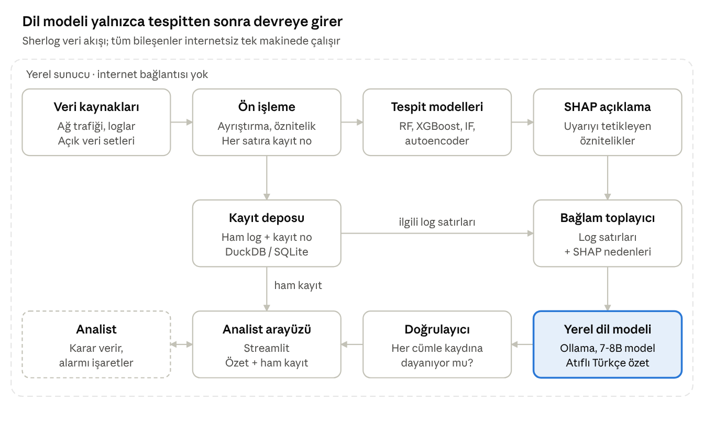

# Sherlog

**Siber güvenlik kayıtları için anomali tespiti ve yerel dil modeliyle kaynağa bağlı olay özeti.**

Sherlog iki katmanlı bir boru hattıdır. Makine öğrenmesi modelleri ağ trafiği ve log kayıtlarında anomaliyi bulur; internetsiz çalışan yerel bir dil modeli, bulunan olayı her cümlesi ilgili log kaydına atıflı bir Türkçe özetle analiste açıklar. Tüm bileşenler tek makinede, internet bağlantısı olmadan çalışır.



| Katman | Depo | Sorumlu |
| --- | --- | --- |
| Tespit: veri işleme, anomali tespiti, SHAP | bu depo | Halime Şahnur Çöğür |
| Dil modeli: bağlam, yerel LLM, doğrulayıcı | [sherlog-llm](https://github.com/Yagmurkalyoncu/sherlog-llm) | Yağmur Kalyoncu |

## Durum

| Bileşen | Durum |
| --- | --- |
| Veri ön işleme ve kayıt numaralandırma | Çalışıyor |
| Random Forest ve Isolation Forest karşılaştırması | Çalışıyor, ilk sonuçlar aşağıda |
| SHAP ile uyarı nedeni | Çalışıyor |
| Uyarıların dil modeli katmanına aktarımı (`uyarilar.json`) | Çalışıyor |
| Zaman penceresi öznitelikleri | Sıradaki adım |

## İlk sonuçlar

**Veri:** CIC-IDS2017, `Friday-WorkingHours-Afternoon-PortScan` (TrafficLabelling sürümü). 286.096 akış kaydı, 79 öznitelik, kayıtların %55,5'i port taraması.
**Bölme:** %70 eğitim / %30 test, tabakalı, `random_state=42`. Test kümesi 38.188 normal ve 47.641 saldırı akışı içeriyor.
IP adresi, kaynak port ve zaman damgası modele öznitelik olarak verilmedi; verilseydi model saldırganın adresini ezberlerdi.

| Model | Kesinlik | Duyarlılık | F1 | Yanlış alarm oranı | Yanlış alarm | Kaçırılan saldırı |
| --- | --- | --- | --- | --- | --- | --- |
| Random Forest (denetimli) | 1,0000 | 0,9999 | 0,9999 | %0,003 | 1 | 7 |
| Isolation Forest (denetimsiz) | 0,0260 | 0,0017 | 0,0031 | %7,75 | 2.959 | 47.562 |

Ayrıntılar: [`sonuclar/metrikler.json`](sonuclar/metrikler.json)

### Bulgular

1. **Denetimli model bu veri setinde neredeyse kusursuz.** 38.188 normal akıştan yalnızca biri yanlış alarm üretti. Bu, CIC-IDS2017'de port taramasının akış istatistikleriyle kolayca ayrılabildiğini gösteriyor; gerçek ortamdaki başarımı göstermiyor. Modeli başka günlerin verisiyle ve görmediği saldırı türleriyle sınamak sıradaki işimiz.
2. **Denetimsiz model port taramasını tek akış düzeyinde yakalayamadı.** Duyarlılık %0,17'de kaldı ve normal trafiğin %7,75'i yanlış alarm olarak işaretlendi. Bir port tarama akışı tek başına olağan dışı değil: bir iki paketlik kısa akışlar normal trafikte de çok sayıda var. Saldırı, aynı kaynaktan kısa sürede çok sayıda farklı porta giden akışların toplamında görünüyor.
3. **Sonraki adım:** Akışları kaynak IP ve zaman penceresine göre toplayıp (örneğin dakikadaki farklı hedef port sayısı) denetimsiz modeli bu öznitelikler üzerinde yeniden denemek. Bu, etiketli veri olmadan bilinmeyen saldırıları yakalama hedefimiz için kritik.

## Dil modeli katmanına giden uyarılar

Tespit edilen şüpheli akışlar kaynak → hedef çiftine göre gruplanır; her grup bir uyarı olur. Her uyarı, kayıt numaralı log satırlarını ve SHAP nedenlerini taşır. [`sonuclar/uyarilar.json`](sonuclar/uyarilar.json) bu çalıştırmada iki uyarı içeriyor:

| Uyarı | Kaynak → hedef | Akış | Puan | Gerçekte |
| --- | --- | --- | --- | --- |
| U-0001 | 172.16.0.1 → 192.168.10.50 | 47.634 | 0,9999 | Port taraması |
| U-0002 | 192.168.10.25 → 192.168.10.3 | 1 | 0,72 | Normal trafik (yanlış alarm) |

U-0002, dil modeli katmanı için bilerek saklanan bir örnek: özetin düşük güveni ve tek akışlık kanıtı analiste açıkça söylemesi gerekiyor.

Örnek bir uyarı:

```json
{
  "uyari_id": "U-0001",
  "kaynak_hedef": "172.16.0.1 -> 192.168.10.50",
  "akis_sayisi": 47634,
  "puan": 0.9999,
  "kayitlar": ["L38601", "L38757", "..."],
  "satirlar": [
    {"id": "L38601", "metin": "7/7/2017 1:55 172.16.0.1:54987 -> 192.168.10.50:22 proto=6 ileri_paket=2 geri_paket=1 sure_us=591"}
  ],
  "nedenler": [
    {"oznitelik": "Fwd Packet Length Mean", "etki": 0.0585},
    {"oznitelik": "Packet Length Mean", "etki": 0.0486},
    {"oznitelik": "PSH Flag Count", "etki": 0.0383}
  ]
}
```

Not: CIC-IDS2017'deki zaman damgaları saniye içermiyor ve öğleden sonraki saatler 12 saatlik biçimde, AM/PM olmadan yazılmış (örneğin 13:55 yerine `1:55`). Bu, veri setinin kendi biçimi.

## Çalıştırma

```bash
pip install -r requirements.txt
# veri/README.md'deki adımlarla CSV'yi indirin
python tespit/temel_model.py --csv veri/Friday-WorkingHours-Afternoon-PortScan.pcap_ISCX.csv --ornek 0
python -m pytest testler
```

`--ornek 0` tüm kayıtları kullanır. Tüm dosya sıradan bir dizüstü bilgisayarda yaklaşık 20 saniyede işleniyor.

## Klasör yapısı

```
tespit/      Anomali tespit modelleri ve SHAP açıklaması
testler/     Birim testleri
sonuclar/    Metrikler ve dil modeli katmanına giden uyarılar
veri/        Veri setleri (depoda tutulmaz)
docs/        Mimari şeması ve raporlar
```

## Ekip

- **Halime Şahnur Çöğür**: tespit katmanı (veri işleme, anomali tespiti, açıklanabilirlik)
- **Yağmur Kalyoncu**: dil modeli katmanı (bağlam, yerel LLM, çıktı doğrulama)

Danışman: Dr. Öğr. Üyesi Merve Özkan, Ankara Üniversitesi Bilgisayar Mühendisliği Bölümü
